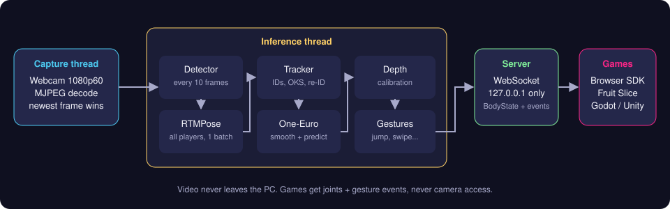

# MotionPlay: a webcam motion console

MotionPlay turns any PC and a webcam into a living-room motion game console.
You stand 1.5-3.5 m from the screen, the camera sees you head to toe, and the
games draw you (or an avatar of you) on the TV. Your body is the controller.

**Example:** in *Fruit Slice*, fruit flies up the screen; you swing your hand
fast through it in the air and it splits in two. Raise both hands to start.

Everything runs on your computer. Video is never recorded and never leaves
the machine: the engine only listens on `127.0.0.1`.



## What's in this repo

| Part | What it does | Where |
| --- | --- | --- |
| Tracker engine | Camera, then pose AI, then player tracking, smoothing, depth, gestures, then WebSocket | `motionplay/` (Python) |
| Browser SDK | What games use: body data, gesture events, video preview, safety overlay | `motionplay/web/sdk/` |
| Fruit Slice | First launch game (hand speed and position) | `motionplay/web/games/fruit-slice/` |
| Calibration UI | Placement checks, T-pose calibration, camera lock | `motionplay/web/calibrate.html` |
| Body viewer | Live skeletons, IDs, depth, gesture log, timings | `motionplay/web/debug.html` |
| Tests | 40 automated tests (synthetic players, a real model, the server) | `tests/` |

This is **weeks 1-3 of the roadmap** (tracker service, calibration UI,
WebSocket API, one test game) plus parts of weeks 4-8: the gesture library,
2-4 player ID tracking and the segmentation mask. The other five games are
listed in the launcher as "coming next".

## Quick start (Windows + NVIDIA GTX 1650)

```powershell
# 1. Python 3.10 - 3.13, then in the repo folder:
python -m venv .venv
.venv\Scripts\activate
pip install -e ".[mediapipe]"

# 2. Pick ONE GPU runtime (default is CPU-only onnxruntime):
pip uninstall -y onnxruntime
pip install onnxruntime-directml            # easiest: any DirectX 12 GPU, no CUDA install
#   or, fastest on NVIDIA (TensorRT FP16 needs TensorRT 10 installed too):
# pip install "onnxruntime-gpu[cuda,cudnn]" # pulls CUDA 13 + cuDNN 9 as pip packages

# 3. Download models, measure this PC, start
motionplay models download
motionplay bench          # times every model here and picks a quality tier
motionplay run --open     # opens http://localhost:8765/
```

Then: **Calibrate** (stand on a tape mark 2 m from the camera, T-pose), then play **Fruit Slice**.

### No camera? Try it anyway

```bash
motionplay run --source synthetic:demo --open   # animated test player (demo|fruit|duo|cross|leave_return|quad)
motionplay run --source video:my_clip.mp4       # a recorded clip as the camera
```

Opening a game with `?mouse` in the address (or with no engine running) uses
the mouse as your right hand.

## Commands

| Command | What it does |
| --- | --- |
| `motionplay run` | Start the engine and web server. `--source`, `--backend auto/rtmpose/rtmo/mediapipe`, `--tier full/balanced/lite`, `--segmentation`, `--no-video` (parental mode), `--set key=value` |
| `motionplay models list / download` | See and download model weights (`~/.motionplay/models`) |
| `motionplay bench` | Time the models on this PC and save the best tier for 60 Hz (or 30 Hz) |
| `motionplay cameras` | List cameras and whether 1080p60 MJPEG works on each |
| `motionplay config show / set key value` | Saved settings (`~/.motionplay/config.json`) |
| `motionplay run --record-keypoints f.jsonl` then `motionplay replay f.jsonl --threshold swipe_speed=5` | Record joint positions only (never video) and re-tune gestures offline |
| `python scripts/trtexec_bench.py` | Day-one TensorRT FP16 check with NVIDIA's `trtexec` |

## How it works

1. **Capture thread.** Asks the webcam for 1080p60 MJPEG (the only way 1080p60
   fits through USB 2.0) and always keeps just the newest frame. If inference is
   slow, old frames are dropped, not queued (queues add lag).
2. **Inference thread.** Runs the person **detector** (RTMDet-nano) every 10 frames.
   The other frames reuse each player's tracked box. **RTMPose-m** (Halpe26, which
   has 26 points including heels and toes) then runs on all player crops in **one
   batch**. ONNX Runtime picks TensorRT FP16, then CUDA, DirectML, CoreML, then CPU.
3. **Tracker.** Gives stable player numbers 1-4. It matches by box overlap, plus
   whole-skeleton similarity (OKS) when two players overlap, plus shirt-colour
   re-identification for players who step out for under 2 s.
4. **Smoothing.** A One-Euro filter on every joint removes jitter when still and
   keeps lag low when moving fast. Joints are predicted one frame ahead to hide
   camera delay. Unsure joints are held for 5 frames, then hidden.
5. **Body maths.** Gives distance from body size, using the median of shoulder
   width, torso and head (so turning sideways doesn't read as stepping back). It
   also gives play-area checks and lighting checks.
6. **Gestures.** jump, squat, punch, swipe, arm raise and lean. Each is measured
   in *torso lengths*, so kids and adults produce the same numbers. Each has
   hysteresis and a cool-down so one jump never fires twice.
7. **Server.** Sends JSON to games over `ws://127.0.0.1:8765/ws`: body states and
   gesture events, plus an optional JPEG preview and mask. Games never touch the
   camera. See [docs/PROTOCOL.md](docs/PROTOCOL.md).

### Plan to code map

| Plan section | Code |
| --- | --- |
| Camera mode 1080p60, MJPEG, exposure lock 1/120 s | `capture/sources.py`, `capture/uvc.py` |
| Model picks (RTMDet-nano, RTMPose-m Halpe26, RTMO, MediaPipe, segmentation) | `vision/models.py`, `vision/rtm.py`, `vision/mediapipe_backend.py` |
| TensorRT FP16 / CUDA / DirectML providers | `vision/runtime.py` |
| Three threads + newest-frame buffer | `engine.py`, `capture/buffer.py` |
| ByteTrack + OKS + HSV re-ID, 2 s re-attach | `tracking/tracker.py` |
| One-Euro, per-joint beta, gating, prediction | `tracking/filters.py`, `tracking/smoothing.py` |
| Depth from calibrated sizes (median of 3) | `body/depth.py` |
| Placement, lighting, T-pose calibration, play area | `body/checks.py`, `body/calibration.py` |
| Gesture detectors to GestureEvent | `gestures/engine.py` |
| Input abstraction (BodyState + events over WebSocket) | `protocol.py`, `server.py`, `web/sdk/motionplay.js` |
| Privacy & safety (camera-on dot, skeleton-only, parental, 20-min break, clear space) | `web/sdk/overlay.js`, `config.py` (`privacy`) |
| Model tiering by first-launch benchmark | `bench.py`, `vision/factory.py` |
| 3+ players over budget: pose every 2nd frame + prediction | `engine.py` (`crowded_pose_divisor`) |

## Writing a game

```html
<script type="module">
  import { MotionPlay } from "/sdk/motionplay.js";
  import { installOverlay } from "/sdk/overlay.js";   // camera dot, breaks, "step back in"

  const mp = new MotionPlay({ video: true });
  installOverlay(mp);
  mp.on("gesture", (g) => {
    if (g.gesture === "jump") console.log(`player ${g.player_id} jumped`);
  });
  mp.on("frame", () => {
    for (const body of mp.bodies()) {
      const hand = body.hand("right");             // {x, y, c}: 0..1, mirrored like a mirror
    }
  });
</script>
```

Put the game in `motionplay/web/games/<name>/` and it is served at
`http://localhost:8765/games/<name>/`. Any engine (Godot, Unity) can connect
to the same WebSocket instead.

## What was checked, and what still needs your PC

| Thing | Status | Source of the number |
| --- | --- | --- |
| Tracking, IDs through crossings, gestures, calibration, server, privacy rules | 40 tests pass | `pytest` on synthetic players with exact ground truth |
| A real neural net through the whole engine | MediaPipe lite tracked the test player in 90/90 frames (8.4 px median error at 720p); jump, squat and lean detected | measured in this repo's test environment (4-core CPU, no GPU) |
| Engine overhead | ~1 ms tracking + smoothing + gestures per frame; 2.6 ms capture-to-send with the synthetic source | `/api/status` timings measured here |
| Fruit Slice, calibration, launcher, viewer in a real browser | No console errors; screenshots reviewed | headless Chromium |
| RTMPose/RTMDet ONNX code path | Tested with stand-in ONNX models with the same inputs/outputs | `tests/test_vision_onnx.py` |
| **RTMPose speed on a GTX 1650 (plan: 5-7 ms for 2 players)** | **Not measured yet**: OpenMMLab's download server was blocked in the build environment, and it had no GPU | run `motionplay bench` on your PC |
| **Gesture thresholds on real people** | Tuned on synthetic players; with a real model the arm gestures (punch, swipe) were noisier | record yourself with `--record-keypoints`, tune with `motionplay replay` |
| Webcam exposure lock | Written for DirectShow/MSMF/V4L2 unit conventions; needs a real camera to confirm | calibration result card shows what the camera reported |

Two plan numbers changed after measuring:
- **Squat threshold.** The plan said hip-to-knee gap under 0.6x. With the camera
  near hip height, the knees come towards the lens and the gap only shrinks to
  ~0.72x, so squat uses 0.8x **plus** a hip drop of 0.3 torso lengths.
- **Segmentation model.** The multiclass selfie model took ~70 ms per frame on
  CPU; the landscape selfie model took ~3 ms, so it is the default
  (`vision.segmentation_model`).

## Sources and credits

- **RTMPose / RTMDet / RTMO models and URLs**: OpenMMLab MMPose,
  `projects/rtmpose/README.md` (Apache-2.0). Pre/post-processing follows
  [rtmlib](https://github.com/Tau-J/rtmlib) (Apache-2.0).
- **Halpe26 keypoints, links and OKS sigmas**: MMPose `configs/_base_/datasets/halpe26.py`.
- **MediaPipe Pose Landmarker and selfie segmenters**: Google MediaPipe model cards (Apache-2.0).
- **One-Euro filter**: Casiez, Roussel & Vogel, *1 Euro Filter*, CHI 2012.
- **ByteTrack**: Zhang et al., *ByteTrack*, ECCV 2022. **OKS**: the COCO keypoint metric.
- YOLO-Pose was not used because Ultralytics is AGPL-3.0 (a paid licence is
  needed for a shipped game); the whole MMPose stack is Apache-2.0.

## Development

```bash
pip install -e ".[dev,mediapipe]"
pytest                       # 40 tests, ~45 s
```

MIT licensed (see `LICENSE`). Model weights keep their own licences (all Apache-2.0 above).
